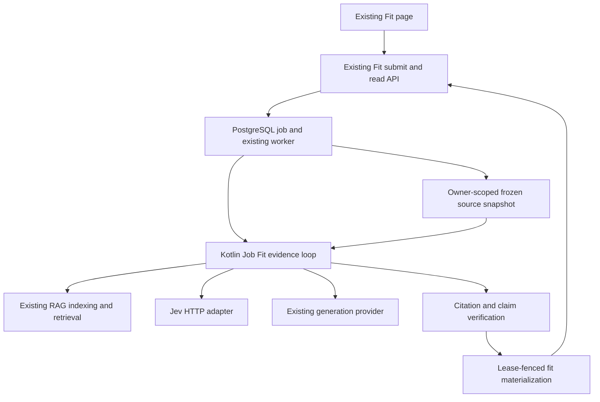
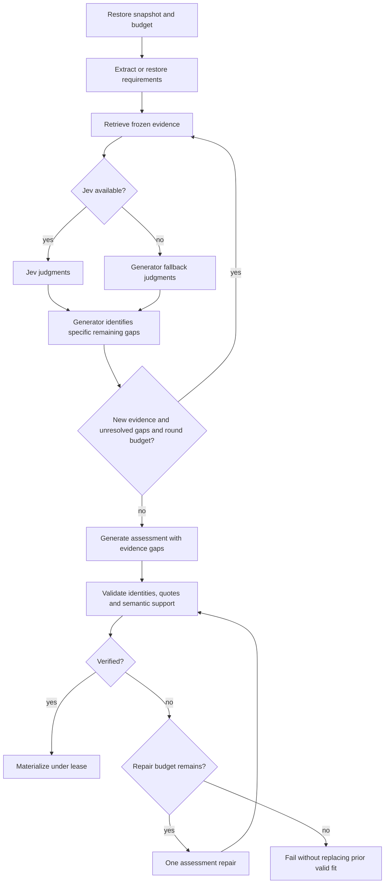
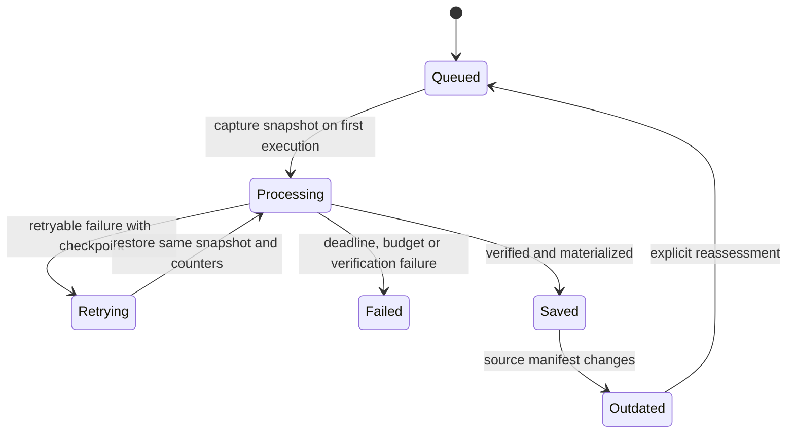

# Agentic Job Fit - Plan

## Goal Capsule

- **Objective:** Candidates can see which target-job requirements their recorded experience supports, inspect the evidence, and identify gaps without mistaking missing documentation for missing ability.
- **Means:** Extend existing Job Fit with a Kotlin-owned evidence loop and Jev judgments (KTD1, KTD4).
- **Authority:** Product Contract governs behavior; Planning Contract governs mechanisms; units implement both. This unified plan is canonical; the origin interview is historical context.
- **Execution profile:** Deliver U1–U8 in dependency order. Feature remains disabled by default until the evaluation gate passes. Planning readiness does not mean the provider or feature has been tested.
- **Stop conditions:** Surface a change requiring new product scope or an infeasible settled decision. Missing live credentials block live proof and default enablement, not offline implementation.
- **Tail ownership:** The implementer owns integration, verification, documentation and removal of abandoned approaches. Publishing, deployment and default enablement require their respective existing authorization and release gates.

---

## Product Contract

### Summary

Upgrade the existing Job Fit action to gather evidence iteratively across a selected resume, a required target job and the user's saved experiences.
Show requirement-level evidence statuses and inspectable citations alongside the overall fit score.
Keep the current background-job interaction and introduce the new behavior behind a configuration flag.

### Problem Frame

Current Job Fit builds one context from the resume and target job, then generates its assessment.
It cannot retrieve a saved experience omitted from the resume or explicitly search again for an unresolved requirement.
The present matched/missing split also cannot express partial support or distinguish undocumented skills from absent skills.

### Key Decisions

- **Improve existing Job Fit first** (session-settled: user-directed — chosen over a new Ask feature: improve the current workflow). Governs R1.
- **Broaden candidate evidence** (session-settled: user-approved — chosen over resume-only evidence and an optional target job: include experience omitted from the resume). Governs R2, R3.
- **Make support inspectable** (session-settled: user-approved — chosen over a binary matched/missing result: preserve partial support, conflicts and evidence gaps). Governs R4, R5, R6.
- **Bound and verify the assessment** (session-settled: user-approved — chosen over unlimited searches and saving unchecked output: control execution and ground the final claims). Governs R7, R8, R9.
- **Preserve historical meaning** (session-settled: user-approved — chosen over silently changing saved results: snapshot sources and expose outdated results). Governs R11.
- **Evaluate before default rollout** (session-settled: user-approved — chosen over immediate default enablement: compare against current Job Fit). Governs R12.

### Requirements

**Workflow and sources**

- R1. The existing Job Fit action becomes agentic first; other coaching workflows retain current behavior during this delivery.
- R2. Each agentic run uses one selected ready resume and one required target job owned by the submitting user.
- R3. All that user's saved experiences are eligible for retrieval, with no arbitrary first-page or newest-record cutoff.

**Evidence and output**

- R4. Each target-job requirement receives Supported, Partially supported, or Not established evidence status. Not established means the records do not establish it.
- R5. Supported and Partially supported requirements cite specific frozen resume passages or saved-experience passages. Target-job passages establish the requirement, not the candidate's ability.
- R6. Contradictory candidate records are flagged with both sources; a disputed claim cannot be fully supported without resolving the contradiction from evidence.
- R7. Permit one initial retrieval and at most two follow-up retrieval rounds targeting unresolved requirements. Stop earlier when sufficient or when a completed round adds no new evidence.
- R8. The generation model may challenge a sufficient judgment by naming a specific unsupported part and requesting retrieval within R7's shared budget.
- R9. Before saving, validate citation identities and claim support. Allow at most one final-assessment repair; if the repaired assessment still fails verification, fail the run rather than save unchecked output.
- R10. Keep the overall fit score and explain it through evidence statuses; it represents documented fit, not hiring probability.

**Lifecycle and rollout**

- R11. Freeze source content and identities for a run; source additions, edits and deletions make its saved result outdated without mutating it.
- R12. Keep agentic Job Fit behind a configuration flag until comparison evaluation demonstrates valid citations, zero unsupported Supported judgments in the reviewed set, and improved evidence coverage over current Job Fit. Report latency and model-call cost.
- R13. If Jev is unavailable, the generation model takes over judgments in the same bounded loop. Record judgment provenance and visibly disclose fallback use.
- R14. Show brief progress and an expandable explanation of evidence, retrieval and fallback use; expose decision summaries rather than private model reasoning.
- R15. Enforce an overall run deadline and provider-call limits, including retries. Calibrate numerical limits from measured runs and worker behavior before default enablement.

### Acceptance Examples

- AE1. **Covers R2–R5:** A saved project omitted from the resume explicitly describes deploying Kubernetes. Job Fit can cite that experience for the selected target job's Kubernetes requirement.
- AE2. **Covers R4–R8:** A resume mentions Docker but not production Kubernetes. Docker alone cannot establish Kubernetes; the agent searches other eligible experience and reports the remaining gap if no support appears.
- AE3. **Covers R6:** Two records give incompatible ownership of the same project. The assessment cites both and does not present disputed ownership as established.
- AE4. **Covers R7, R13:** Jev times out after initial retrieval. The generator judges the evidence and may request follow-up retrieval without resetting the round count.
- AE5. **Covers R9:** Generated output cites an unknown passage. Validation rejects it; one repair is verified again, and a repeated failure produces a failed job without replacing the last valid fit.
- AE6. **Covers R11:** A user adds, renames or deletes an experience after a successful fit. That fit becomes outdated; reassessment uses a new snapshot.
- AE7. **Covers R1, R12:** With the flag disabled, current Job Fit and other coaching workflows retain their existing outputs and behavior.

### Scope Boundaries

**Deferred to Follow-Up Work:** Apply the proven loop to experience suggestions, practice questions and answer feedback; evaluate local Laya as an alternative judge.

**Not in this delivery:** Ask/chat, MCP endpoints, a Python orchestration service, web search, new external document sources, new embedding providers, a general agent framework, or autonomous edits to candidate records.

### Origin Preservation

Product Contract preserves the confirmed scope in the origin interview, assigning R1–R15 to its previously unnumbered decisions.
The generator fallback supersedes the earlier single-pass outage fallback; Jev-first supersedes local-Laya-first.

---

## Planning Contract

### Current Code and Constraints

- `src/main/kotlin/dev/jiaming/ai_interview/fit/JobFitJobHandler.kt` under `src/main/kotlin/dev/jiaming/ai_interview/` resolves documents at execution time, checkpoints a complete `JobFitResult`, then materializes it through `JobExecutionContext`.
- `src/main/kotlin/dev/jiaming/ai_interview/coach/CoachRagContextService.kt` implements deterministic source-separated retrieval with whole-text/local fallback. Preserve that implementation for flag-off and unrelated workflows.
- `src/main/kotlin/dev/jiaming/ai_interview/document/DocumentSourceType.kt` and `src/main/resources/db/migration/V7__document_references_and_rag_indexes.sql` currently allow only resume and target-job indexing; experiences require explicit support.
- `src/main/kotlin/dev/jiaming/ai_interview/suggestions/SuggestionsService.kt` supplies an owner-scoped experience-loading precedent and read-time source-set freshness checks.
- `src/main/kotlin/dev/jiaming/ai_interview/fit/JobFitService.kt` deduplicates active submissions by pair. `JobFitResult` is parsed from existing saved JSON, so mandatory new fields would break historical results.
- `src/main/kotlin/dev/jiaming/ai_interview/jobs/JobWorker.kt` maintains renewable leases and interrupts after lease loss. `JobEffectMaterializationService` fences writes; a visibility timeout is not a total execution deadline.

All file references are relative to the repository root; new file names are proposed implementation targets.

### Key Technical Decisions

- KTD1. **Kotlin orchestration inside the existing background job.** Use a Job Fit-specific service and narrow internal retrieve/judge/generate operations, not arbitrary model-selected tools or SQL. Preserve the existing submit/read/job APIs. (session-settled: user-approved — chosen over separate Python/MCP orchestration: fit the current runtime.) Implements R1, R7, R15.
- KTD2. **Versioned additive result contract.** Retain the existing score, summary, matched/missing arrays and feedback for legacy readers. Add nullable/defaulted agentic metadata with schema version, canonical per-requirement assessments, evidence catalog, source manifest, trace and fallback marker. For agentic results, derive legacy matched entries from Supported and missing entries from the other statuses; the UI uses canonical assessments. Legacy results carry no fabricated verification or freshness guarantees. Implements R4–R6, R9–R14.
- KTD3. **Durable first-attempt snapshot.** Within a short repeatable-read transaction at the first worker attempt, capture the owner's selected documents plus the full sorted experience set and persist a versioned checkpoint before any external calls. Capture execution mode at submission in the versioned job payload; a missing mode decodes as legacy, so queued jobs and retries ignore later flag changes. Retries reuse frozen content. Freshness compares canonical IDs and hashes of every prompt-visible field at read time; compute a separate revision hash because existing experience dedup hashes omit organization/dates. Legacy freshness is unknown. No database transaction spans network calls. Implements R2, R3, R11.
- KTD4. **Jev-first judgment with generator fallback.** Use direct authenticated HTTP through a small Kotlin adapter, with a common typed judgment interface shared by the generator fallback. Keep judgment provenance separate from evidence status and include actual model identity and rubric version. (session-settled: user-directed — chosen over local Laya first: use Jev initially.) The override/fallback preserves R8, R13 rather than silently switching to old retrieval.
- KTD5. **Atomic judgments, code-owned validation.** Decompose the full frozen target-job text once with the existing generator, binding each requirement to target-job evidence; preserve every extracted requirement through the result. Judge relevance per requirement/passage and sufficiency per requirement/evidence bundle. Check citation IDs, frozen source membership and verbatim supporting quotes in code before semantic verification. Validate follow-up requirement IDs, query length and duplicate queries before retrieval. Record contradiction separately from the three evidence statuses. Treat all source text as untrusted data. Implements R4–R9.
- KTD6. **Experience indexes reuse the existing RAG infrastructure.** Extend the internal source enum and database check to include EXPERIENCE, creating `ResolvedDocument` values from frozen experience text. Resolve eligible source handles only from the owner-scoped snapshot; bind returned text to its snapshot source identity, never trust a model-supplied or vector-metadata resource ID. Index identity remains content/model/dimensions/schema based. Do not expose EXPERIENCE as an upload/source-selection API option. Implements R2, R3, R5.
- KTD7. **Deterministic candidate selection before judgment.** Reuse source-separated retrieval, RRF and section diversity within the new Job Fit service. Include every experience in the eligible corpus, but bound query count and prompt evidence. Search unresolved requirements in batches; deduplicate by snapshot passage identity and preserve all prior useful evidence. A local chunk fallback searches the same frozen corpus if vectors are unavailable, with degraded retrieval recorded. Never silently truncate the experience catalog or requirement list. Implements R3, R7.
- KTD8. **A resumable run budget, not per-attempt resets.** Store round count, original deadline, spent/reserved provider attempts, completed operation IDs and repair count in the loop checkpoint. Reserve budget under the current lease before dispatch and never refund an uncertain external call after a crash. Completed results resume without reissuing calls. Exactly-once billing cannot be guaranteed across a provider response/checkpoint crash gap; conservative reservations bound repeats. All HTTP/SDK retries count and obey the remaining deadline. Implements R7, R9, R15.
- KTD9. **Separate schema repair from assessment repair.** Route agentic generation through the existing low-level structured generation client without the hidden repair in `AiResumeCoachService.generateStructured`. One persisted assessment repair budget covers malformed drafts, invalid IDs and failed claim support, followed by mandatory re-verification. Read-only judge transport fallback does not authorize extra assessment drafts. Implements R9.
- KTD10. **Progress through the current job status path.** Add descriptive Job Fit stages to `JobStage`, PostgreSQL/Supabase constraints or projections where needed, the frontend union, labels and mocks together. Persist compact decision traces and frozen citation passages in the saved fit so source inspection survives job retention and record edits. Never emit model chain-of-thought or source text to operational logs. Implements R11, R14.
- KTD11. **Pin the judge and validate its wire contract.** Initial evaluation target is configurable `jev-1.14.0`, not the moving `jev-latest` alias. Implement `POST /v1/systemone` with Bearer auth; validate named answers, enum values, finite probabilities and response model. Match one request's state to its questions, batching only questions sharing that state. Follow [System One API](https://docs.typesafe.ai/api/system-one), [model identity guidance](https://docs.typesafe.ai/models) and [retry/error rules](https://docs.typesafe.ai/api/errors). Pin availability is a live prerequisite, not proven here.
- KTD12. **Guarded rollout and historical compatibility.** Flag defaults off and only controls new runs. Serve both old and new result versions, resume old complete checkpoints, and keep additive schema migrations when disabling the flag. Agentic failures retain the last successful fit. No partial assessment is materialized as success. Implements R9, R11, R12.
- KTD13. **Private execution checkpoints.** Existing `JobStatusResponse.from` and `SupabaseJobStatusReader` forward stored result payloads even while processing. For agentic Job Fit only, status API results are null until successful completion, and the exposed Supabase projection cannot return private checkpoint state. Scope any projection/privilege changes to this new state; preserve the checkpoint visibility contract of legacy and unrelated job types. Keep progress in safe stage metadata. Implements R11, R14.

### High-Level Technical Design

Component and data boundaries:

Loop and decision gates (R7–R9, R13; KTD5, KTD8, KTD9):

Lifecycle and source freshness:

Result and judgment contract shape, directional rather than implementation code:

| Record | Required meaning |
|---|---|
| Requirement assessment | Stable run-local requirement ID, target-job references, evidence status, candidate citation IDs, conflict references and missing-evidence description |
| Evidence catalog entry | Opaque ID namespaced by snapshot/source/passage, source kind and resource identity, immutable source label, passage and quote |
| Judgment | Requirement ID, judged/unchecked state, judge provider/model, status, evidence IDs, missing evidence, rubric version and optional provider probabilities |
| Execution checkpoint | Version, mode, snapshot, stage, rounds, budgets, completed operations, evidence, judgments and final verified result if available |
| Fit metadata | Result version, source manifest, canonical assessments, evidence catalog, compact trace and fallback use |
| Fit view freshness | CURRENT, OUTDATED or UNKNOWN; computed independently of whether a newer job is running |

Mode behavior:

| New-run flag | Judge state | Behavior |
|---|---|---|
| Off | Any | Existing one-pass Job Fit; historical result shape remains readable |
| On | Jev works | Jev judgments plus generator challenge, per R8 |
| On | Jev missing/invalid credentials, transient transport failure or exhausted 429/529 retries | Generator judgment fallback, visibly recorded, with a redacted operational error |
| On | Invalid request or response contract (400/413/415/422, missing answers, malformed JSON) | Fail with an integration error; do not hide adapter defects as provider outages |
| On | Active judge cannot verify repaired draft | Failed job; previous successful result retained |

### Assumptions and Implementation-Time Calibration

- Snapshot capture is first execution, not submission time (KTD3). Record the capture time; queued changes before capture are included, changes afterward affect freshness.
- Additive JSON metadata in existing `result_payload` and `FitView` is sufficient; no new source-content table is needed. Persist checkpoints using existing private background-job storage, then carry required immutable evidence into the saved fit.
- Experimental numerical limits must be finite configuration before enabling the flag in any environment. U8 chooses values through measurements; configuration validation rejects flag-on with absent or invalid deadline/call/prompt budgets. Bound requirements, queries per round, candidate judgments, prompt tokens and indexing/embedding attempts as well as generation/Jev calls. Oversized input fails explicitly rather than silently dropping requirements or experiences. Each provider request uses the lesser of its configured timeout and remaining run time.
- Budget exhaustion before final verification is a failed run. Normal retrieval-cap/no-new-evidence stops can still yield a verified assessment containing Not established entries.
- Source deletion revokes eligibility for future runs and makes prior results outdated. Historical citations stay in the owner-only result until its parent fit/account lifecycle removes them; parent deletion and foreign-owner access follow existing API behavior.

### System-Wide Impact and Risks

- **Shared enum and migration:** use a new migration after current V20, never rewrite V7. Audit all exhaustive source-type branches and contract-freeze checks. Widen only the indexing check; preserve private schemas and runtime-role grants.
- **Leases and retries:** do not swallow interruption/lease loss inside existing indexing fallback handlers. Check lease ownership and budget before each external operation and checkpoint; never hold a database lock across network calls.
- **Provider trust:** only bounded necessary passages leave the application. Keep `TYPESAFE_API_KEY` server-side and redact auth and source text. Treat low-confidence judgments as unresolved; malformed wire responses follow the integration-error row in the mode table. Adopt code-first quote checks and semantic verification from [TypeSafe's citation cookbook](https://docs.typesafe.ai/cookbooks/citation_check); cookbook example thresholds are not calibrated project thresholds.
- **Private checkpoint projection:** `src/main/resources/db/migration/V9__job_status_frontend_contract.sql` exposes `result_payload` through `ai_interview_api.job_status`. U6 must add a forward migration guarding this projection for non-succeeded agentic Fit jobs, alongside the JDBC guard in KTD13, and verify the exposed role cannot retrieve sentinel checkpoint content.
- **Snapshot volume:** the whole owner experience catalog is eligible but does not go wholesale into each prompt. Page database reads inside the consistent snapshot and batch indexing/retrieval within finite prompt and deadline limits.
- **Caching and identity:** include snapshot and rubric/model versions when caching judgments. Reused content-addressed indexes never establish ownership; snapshot membership does.
- **Serializer boundaries:** Spring Boot 4 MVC and application mappers differ in this repo. Follow `docs/solutions/integration-issues/patch-body-bound-to-jackson-2-jsonnode-returns-500-on-spring-boot-4.md`: real-controller contract coverage complements MSW and service tests.

---

## Implementation Units

### U1. Define compatible evidence and result contracts

**Goal:** Establish shared, versioned data contracts before changing runtime behavior.

**Requirements:** R4–R6, R9–R11, R13–R14; KTD2, KTD5, KTD10, KTD12.

**Dependencies:** None.

**Files:** Modify `src/main/kotlin/dev/jiaming/ai_interview/fit/JobFitResult.kt`, `src/main/kotlin/dev/jiaming/ai_interview/fit/FitView.kt` under the same Kotlin package root, `apps/web/lib/api/types.ts`, `docs/api/frontend-api-contract.md`; create `src/main/kotlin/dev/jiaming/ai_interview/fit/JobFitEvidence.kt` and `src/test/kotlin/dev/jiaming/ai_interview/fit/JobFitResultTests.kt`; update `src/test/kotlin/dev/jiaming/ai_interview/contract/ContractFreezeTests.kt` and `apps/web/tests/apiShapes.test.ts`.

**Approach:** Specify the directional contract above as concrete DTOs with backward-compatible defaults. Keep canonical assessments and legacy projections consistent under KTD2; separate judgment provenance, confidence and evidence status.

**Patterns to follow:** Existing result DTOs and API contract sections 6.1–6.2 and 8.2.

**Test scenarios:**

1. Existing populated and empty saved fit JSON decodes with agentic metadata absent and freshness UNKNOWN.
2. New result JSON round-trips all three statuses, conflicts, source references and fallback provenance through application and MVC serialization.
3. Invalid status, cross-snapshot citation or malformed judgment cannot masquerade as supported evidence.
4. Existing frontend consumers still read legacy fields; canonical status-to-legacy projections agree.

**Verification:** Backend and frontend contract tests prove old/new payload compatibility without changing flag-off behavior.

### U2. Freeze owner-scoped source inputs and compute freshness

**Goal:** Make retries and historical evidence independent of mutable live records.

**Requirements:** R2, R3, R11; KTD3, KTD8, KTD12.

**Dependencies:** U1.

**Files:** Create `src/main/kotlin/dev/jiaming/ai_interview/fit/JobFitSourceSnapshotService.kt`, `src/test/kotlin/dev/jiaming/ai_interview/fit/JobFitSourceSnapshotServiceTests.kt`; modify `src/main/kotlin/dev/jiaming/ai_interview/fit/JobFitService.kt`, `src/main/kotlin/dev/jiaming/ai_interview/fit/JobFitJobHandler.kt`, `src/main/kotlin/dev/jiaming/ai_interview/jobs/JobFitPayload.kt` as needed for backward decoding, `src/main/kotlin/dev/jiaming/ai_interview/document/DocumentReferenceResolver.kt`, and `src/integrationTest/kotlin/dev/jiaming/ai_interview/fit/JobFitIntegrationTests.kt`.

**Approach:** Capture a deterministic manifest with full frozen text for execution and stable source hashes for freshness per KTD3. Follow owner-scoped loading in `src/main/kotlin/dev/jiaming/ai_interview/suggestions/SuggestionsService.kt`. Compare the full experience set, including additions/deletions, rather than only cited records. Persist only the evidence required for historical inspection in the fit result.

**Test scenarios:**

1. Covers AE1. An older experience outside the first database page is included; no foreign-owner experience is captured.
2. Missing/foreign/not-ready selected documents preserve existing errors before provider calls.
3. Concurrent rename/add/delete produces a consistent snapshot; retry restores it without loading new source text.
4. Covers AE6. Addition, rename/hash change and deletion mark the prior result OUTDATED; ordering alone does not.
5. Legacy results report UNKNOWN and remain viewable; source changes during a run can make its eventual saved result immediately OUTDATED.

**Verification:** PostgreSQL integration coverage proves consistency and owner isolation, not just mock manifest comparisons.

### U3. Retrieve experiences alongside resume evidence

**Goal:** Search all eligible source kinds with citations bound to the snapshot.

**Requirements:** R2, R3, R5–R7; KTD6, KTD7.

**Dependencies:** U2.

**Files:** Modify `src/main/kotlin/dev/jiaming/ai_interview/document/DocumentSourceType.kt`, `src/main/kotlin/dev/jiaming/ai_interview/rag/RagContextId.kt`, `src/main/kotlin/dev/jiaming/ai_interview/rag/RagIndexingService.kt`, `src/main/kotlin/dev/jiaming/ai_interview/rag/RagRetrievalService.kt` and affected exhaustive source mappings; create the next unused migration under `src/main/resources/db/migration/` to widen the RAG indexing source check; create `src/main/kotlin/dev/jiaming/ai_interview/fit/JobFitEvidenceRetriever.kt` and `src/test/kotlin/dev/jiaming/ai_interview/fit/JobFitEvidenceRetrieverTests.kt`; extend `src/integrationTest/kotlin/dev/jiaming/ai_interview/rag/RagDocumentIndexRepositoryIntegrationTests.kt` and existing RAG unit tests.

**Approach:** Apply KTD6–KTD7 in a new Job Fit retrieval boundary while retaining `CoachRagContextService` behavior. Use deterministic source/passage identities independent of mutable labels and current resource contents. Rebind content-addressed vector passages to authorized frozen sources before citation creation.

**Test scenarios:**

1. Covers AE1. A saved experience supplies decisive evidence unavailable in the resume.
2. Identical text owned by two users may reuse an index but never leaks the other user's identity or records.
3. Experience vectors persist under the new check; legacy resume/target-job indexes still load after migration.
4. Vector unavailability searches frozen local chunks and records degradation; interruption propagates rather than continuing fallback work.
5. Duplicate passages and query ordering produce deterministic evidence; a full round with no new passage is detectable.

**Verification:** Repository migration integration and retrieval tests prove all three source kinds and flag-off regressions.

### U4. Add typed Jev and generator judgment adapters

**Goal:** Make judgments explicit, validated and replaceable without moving orchestration out of Kotlin.

**Requirements:** R4, R6, R8, R13, R15; KTD4, KTD5, KTD11.

**Dependencies:** U1.

**Files:** Create `src/main/kotlin/dev/jiaming/ai_interview/fit/judging/EvidenceJudge.kt`, `src/main/kotlin/dev/jiaming/ai_interview/fit/judging/JevEvidenceJudge.kt`, `src/main/kotlin/dev/jiaming/ai_interview/fit/judging/GenerationEvidenceJudge.kt`, and `src/main/kotlin/dev/jiaming/ai_interview/fit/judging/JevProperties.kt` in that directory; create corresponding tests under `src/test/kotlin/dev/jiaming/ai_interview/fit/judging/`; modify `src/main/resources/application.yaml`, `.env.example`, and provider wiring as necessary; add versioned judgment prompt files alongside current resources.

**Approach:** Implement KTD4, KTD5 and KTD11 through the existing HTTP/configuration style without adding an orchestration SDK. Keep retrieval relevance, requirement sufficiency and final claim support as distinct questions. Validate ID/quote selection by the generator in code. Use a finite, shared retry policy rather than layered hidden retries.

**Test scenarios:**

1. Valid named Jev judgments decode with actual model identity and usage; unchecked and low-certainty responses never imply support.
2. Missing answers, unknown labels, wrong model, non-finite/out-of-range probabilities and malformed JSON fail as integration errors rather than silently activating fallback.
3. Missing key, timeout, 401/422, 429 and 529 have explicit behavior; transient retry respects Retry-After and the run budget, permanent failures do not retry.
4. Covers AE4. Generator fallback receives frozen evidence and produces the same internal judgment contract.
5. Source text containing instructions cannot choose tools, replace the rubric or introduce unauthorized source IDs.

**Verification:** HTTP stub contract tests pass offline; a separately opted-in live smoke validates the pinned model and response schema before enabling the feature.

### U5. Implement the bounded evidence loop and final verification

**Goal:** Produce only a verified assessment after targeted evidence collection.

**Requirements:** R4–R10, R13, R15; KTD1, KTD4, KTD5, KTD7–KTD9.

**Dependencies:** U2, U3, U4.

**Files:** Create `src/main/kotlin/dev/jiaming/ai_interview/fit/AgenticJobFitService.kt`, `src/main/kotlin/dev/jiaming/ai_interview/fit/JobFitExecutionState.kt`, `src/main/kotlin/dev/jiaming/ai_interview/fit/JobFitClaimVerifier.kt` in the same directory, and their tests under `src/test/kotlin/dev/jiaming/ai_interview/fit/`; extend `src/main/kotlin/dev/jiaming/ai_interview/coach/CoachPromptBuilder.kt` and Job Fit-specific prompt resources; reuse `src/main/kotlin/dev/jiaming/ai_interview/coach/StructuredGenerationClient.kt`.

**Approach:** Persist requirement extraction, evidence, typed judgments and completed operations as explicit stages. Keep all extracted target-job requirements in the final canonical assessments, including unresolved ones. An agent challenge records a specific gap and cannot reset search state. Apply code-first identity/quote checks, then semantic claim verification; regenerate the full score/summary/projections when a rejected claim changes the assessment.

**Execution note:** Prove the branching loop with fake providers and a fake clock before connecting live inference.

**Test scenarios:**

1. Covers AE2. Docker evidence cannot fully support Kubernetes; a targeted follow-up either finds support or preserves the gap.
2. Zero, one and two follow-ups stop correctly; repeated queries/no-new-evidence stop early and unresolved requirements remain visible.
3. Jev-sufficient evidence can be challenged only with a specific gap and remaining budget.
4. Covers AE3. Conflicts remain cited even when one conflicting passage ranks lower.
5. Covers AE5. Unknown citations, fabricated quotes, unsupported claims, and unsupported summary claims consume at most one shared repair; the repair is reverified.
6. Judge outage uses generation fallback; generation failure, deadline or call-budget exhaustion cannot become a successful unverified assessment.
7. Checkpoint restore preserves rounds, reservations, repair count, original deadline and completed model results.

**Verification:** Deterministic loop tests cover every branch without external calls or a second hidden schema-repair loop.

### U6. Integrate durable execution, progress and rollout flag

**Goal:** Run the evidence loop safely through the existing worker lifecycle.

**Requirements:** R1, R9, R11–R15; KTD1, KTD3, KTD8–KTD13.

**Dependencies:** U5.

**Files:** Modify `src/main/kotlin/dev/jiaming/ai_interview/fit/JobFitJobHandler.kt`, `src/main/kotlin/dev/jiaming/ai_interview/jobs/JobExecutionContext.kt`, `src/main/kotlin/dev/jiaming/ai_interview/jobs/JobStage.kt`, `src/main/kotlin/dev/jiaming/ai_interview/jobs/JobEffectMaterializationService.kt`, `src/main/kotlin/dev/jiaming/ai_interview/jobs/JobStatusResponse.kt`, `src/main/kotlin/dev/jiaming/ai_interview/supabase/SupabaseJobStatusReader.kt`, failure classification as needed, `src/main/resources/application.yaml`, `.env.example`, `docker-compose.yml` and deployment manifests that supply worker configuration; add forward migrations for job-stage SQL checks or exposed status projections as required; update `src/test/kotlin/dev/jiaming/ai_interview/fit/JobFitJobHandlerTests.kt`, `src/test/kotlin/dev/jiaming/ai_interview/jobs/JobExecutionContextTests.kt`, `src/test/kotlin/dev/jiaming/ai_interview/jobs/JobWorkerTests.kt`, `src/test/kotlin/dev/jiaming/ai_interview/supabase/SupabaseJobStatusReaderTests.kt`, and `src/integrationTest/kotlin/dev/jiaming/ai_interview/jobs/JobEffectMaterializationIntegrationTests.kt`.

**Approach:** Preserve lease fencing and route flag-off through current Job Fit. Use a versioned nested execution checkpoint that cannot be mistaken for an old completed root result. Promote only a verified final result to the existing materialization path. Carry finite config and call accounting through both judge modes; report safe stage/counter metadata without source content.

**Test scenarios:**

1. Covers AE7. Flag-off performs existing behavior; enabling/disabling during a retry does not change its captured mode.
2. A crash after budget reservation but before response saves no unchecked result and cannot reset the budget on retry.
3. Heartbeat loss or shutdown interruption stops further model work and prevents checkpoint/materialization by the old lease.
4. Completed legacy root checkpoints materialize compatibly; a partial agentic checkpoint does not qualify as a complete result.
5. Failed reassessment retains the prior valid fit; effect fencing prevents duplicate final writes.
6. Status stages travel through both JDBC and configured Supabase job-status readers without enum/SQL failures.
7. Processing, retrying and failed agentic Fit jobs expose no private snapshot/checkpoint content through JDBC or Supabase status reads; succeeded jobs expose only the public result. Legacy and other job types retain current checkpoint visibility.

**Verification:** Worker and PostgreSQL integration tests prove resume, fencing and old/new job compatibility; live deployment wiring is checked during U8.

### U7. Render evidence, progress and freshness in existing Fit UI

**Goal:** Let candidates inspect the assessment and distinguish gaps, conflicts and outdated results.

**Requirements:** R4–R6, R10–R14; KTD2, KTD10, KTD12.

**Dependencies:** U1, U6.

**Files:** Modify `apps/web/pages/FitPage.tsx`, `apps/web/components/flow/FitCard.tsx`, `apps/web/lib/query/scoring.ts`, `apps/web/lib/api/jobLabels.ts`, `apps/web/lib/api/types.ts`, `apps/web/mocks/fixtures.ts`, `apps/web/mocks/store.ts`, `apps/web/mocks/jobSimulator.ts`; create `apps/web/tests/fit.test.tsx`; update `apps/web/tests/apiShapes.test.ts`, `apps/web/tests/apiScenarios.ts`, `docs/api/frontend-api-contract.md`.

**Approach:** Render canonical assessments when metadata is present, retaining existing legacy rendering otherwise. Show sources with frozen labels/text, conflict pairs, plain-language fallback, freshness and an explicit reassess action. Do not auto-rerun merely because sources changed. Use existing job polling rather than a new streaming transport.

**Test scenarios:**

1. All three statuses, score explanation and source passages render and can be inspected with keyboard navigation.
2. Covers AE3. Both conflict citations remain accessible; fallback is disclosed without exposing provider implementation details in the main flow.
3. Covers AE6. Outdated result remains readable and offers reassessment without an automatic model call.
4. A failed newer job preserves the prior fit with its own freshness and provenance.
5. Legacy/no-result/loading states and API mock/live result shapes remain compatible.

**Verification:** Component and shared API scenario tests pass; a real browser checks the enabled and disabled Fit flows, progress and source inspection.

### U8. Evaluate, calibrate and document the rollout

**Goal:** Supply evidence for safe enablement and operating limits.

**Requirements:** R12, R15; KTD8, KTD11, KTD12.

**Dependencies:** U6, U7.

**Files:** Create synthetic fixtures under `src/test/resources/agentic-job-fit/`, `src/test/kotlin/dev/jiaming/ai_interview/fit/AgenticJobFitEvaluationTests.kt`, an opt-in live evaluation under `src/integrationTest/kotlin/dev/jiaming/ai_interview/fit/AgenticJobFitLiveEvaluationTests.kt`, and `docs/operations/agentic-job-fit.md`; update `README.md`, `.env.example` and `docs/api/frontend-api-contract.md` as required.

**Approach:** Compare baseline and agentic results on the same frozen corpus. Use separate tuning and held-out reviewed cases, including at least the acceptance examples, irrelevant experience, duplicate text, long catalogs and provider outage. Human-reviewed labels and evidence spans define correctness; Jev or the generator cannot grade their own correctness as the sole oracle. Report Jev-primary and generator-fallback results separately. Choose finite settings from measured latency/calls/tokens under worker concurrency, then record the selected values and model/rubric versions.

**Test scenarios:**

1. Deterministic fixture checks reject nonexistent/foreign citations and false Supported judgments independently of provider scores.
2. Held-out live cases compare evidence coverage to baseline, alongside false support, partial support, abstention/gap correctness, calls, tokens, latency and cost.
3. Forced Jev outage demonstrates bounded fallback and visible provenance; provider or key unavailability is reported as skipped/blocked live proof, never a passing evaluation.
4. Large-catalog and lease-loss runs remain bounded and do not silently drop sources; disabling the flag restores baseline for new runs and keeps saved results readable.

**Verification:** R12's reviewed-set gate is documented with reproducible inputs, model identities and selected settings. Default flag remains off if any required proof is missing.

---

## Verification Contract

These are implementation-time gates; no tests or live model calls were run to create this plan.

| Gate | Repository command or evidence | Applicability |
|---|---|---|
| Kotlin unit checks | `./gradlew test` with focused fit, judgment, RAG and job tests during units | U1–U6, U8 |
| PostgreSQL/Redis/LocalStack integration | `./gradlew integrationTest` with Docker available | U2, U3, U6; additive migration, isolation, checkpoint and materialization coverage |
| Combined backend check | `./gradlew check` | Final backend regression gate; includes integration tests in this repository |
| Frontend static checks | `npm --prefix apps/web run typecheck` and `npm --prefix apps/web run lint` | U1, U7 |
| Frontend behavior/build | `npm --prefix apps/web test` and `npm --prefix apps/web run build` | U7 and final regression |
| Real API contract | Existing opt-in `apps/web/tests/liveApi.test.ts` mechanism, using its documented base URL setting | DTO/controller/progress changes; do not replace with mocks alone |
| Judge wire proof | Opt-in pinned-Jev smoke with synthetic source text | U4/U8; credentials stay in authorized server environment |
| Quality gate | Held-out reviewed baseline comparison per R12 | Before default enablement; separate primary/fallback evidence |
| Browser proof | Real Fit page, flag on/off, citations, conflict, outdated result, fallback and failed reassessment | U7/U8 |
| Documentation integrity | `git diff --check` | All units |

There is no root `release:validate` command in the inspected manifests; do not invent one. If additional repo-local release instructions apply at execution, include them in the implementer's final verification report.

---

## Definition of Done

- U1–U8 satisfy their verification outcomes and traced requirements; execution progress is tracked outside this plan.
- R1–R15 and AE1–AE7 have test or reviewed evaluation evidence, with live blockers distinguished from passed checks.
- Existing fit rows/jobs and flag-off workflows remain usable; schema, API, frontend types, mocks and job-stage readers agree.
- No unverified final result can replace a valid saved fit; source ownership, freshness, budgets and lease fencing are covered through real persistence boundaries.
- Default enablement is supported by U8 evidence or remains explicitly blocked and off; missing live proof is not called complete production validation.
- Operational docs specify secrets/configuration, finite budgets, versions, fallback, retained citation behavior, rollback and evaluation reproduction.
- Abandoned experiments, unused adapters and temporary debug output are removed from the final change.
